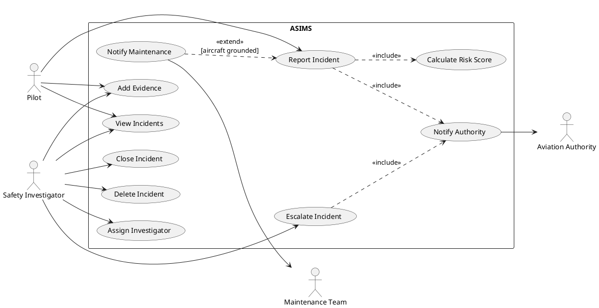
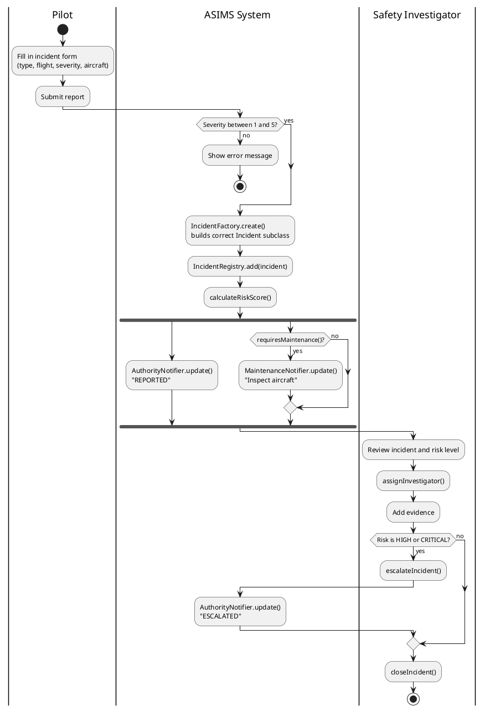
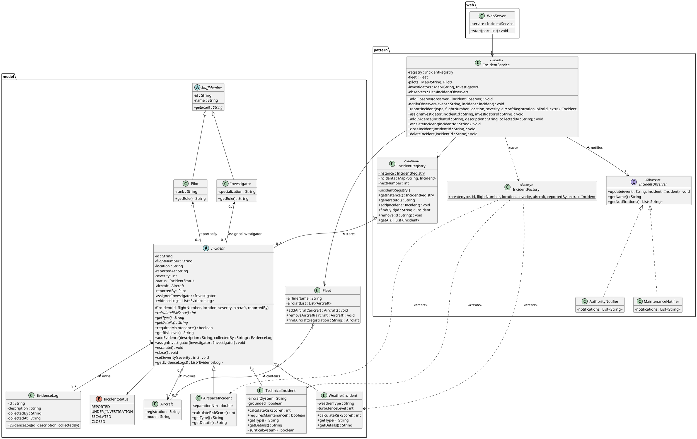
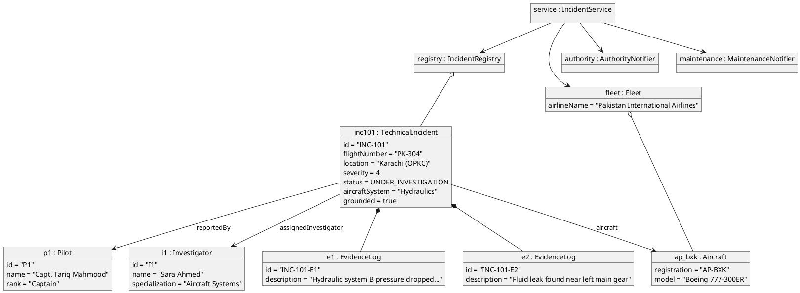
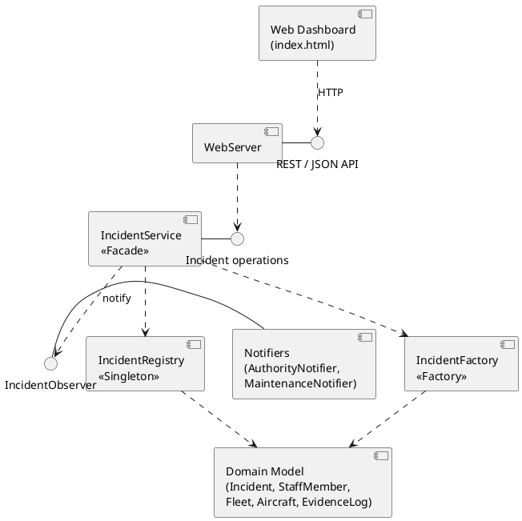
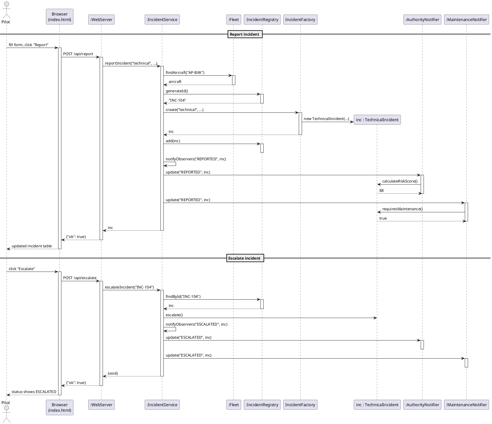
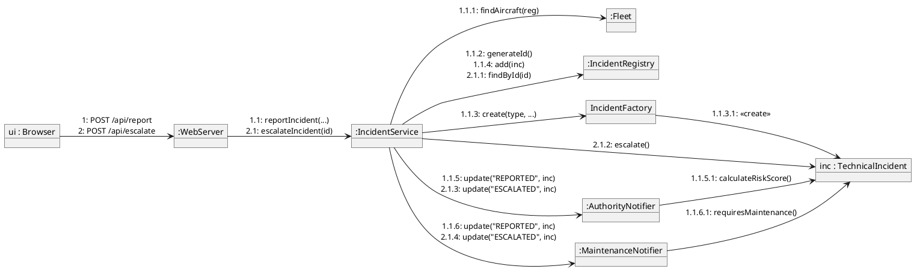
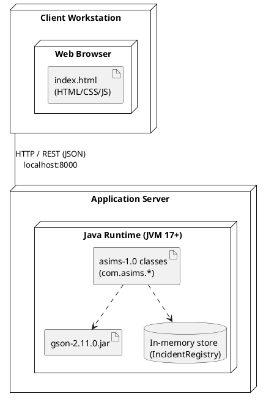

# ASIMS — UML Diagrams

All 8 diagrams are written in **PlantUML**, using the exact class, field and method names from the Java code in `src/main/java/com/asims`.

**How to turn them into images:**
1. Copy a code block into https://www.plantuml.com/plantuml (or use the PlantUML plugin in IntelliJ / VS Code).
2. Export it as PNG for the report.

---

## 1. Use Case Diagram

**Actors:**
- **Pilot**: reports incidents and adds evidence.
- **Safety Investigator**: investigates, escalates and closes incidents.
- **Aviation Authority** and **Maintenance Team**: external actors that receive notifications. This is the Observer pattern.

**Relationships:**
- `<<include>>`: a step that always happens.
- `<<extend>>`: a step that only happens under a condition.

---

## 2. Activity Diagram: Report and handle an incident

**Swimlanes:** Pilot, ASIMS System and Safety Investigator.

**Notation:**
- **Fork/join bar:** the observers are notified "in parallel".
  - This is conceptual. In the code, `notifyObservers()` loops over them one after another.
- **Decision diamonds:**
  - Is the severity valid?
  - Does the aircraft need maintenance?
  - Is escalation needed?

---

## 3. Class Diagram

**Arrow notation:**
- **Filled diamond (`*--`):** composition. Incident → EvidenceLog.
- **Hollow diamond (`o--`):** aggregation. Fleet → Aircraft, IncidentRegistry → Incident.
- **Plain arrow:** association.
- **Triangle:** inheritance.
- **Dashed triangle:** implements an interface.

---

## 4. Object Diagram: snapshot right after startup

This is the state built by `Main.loadSampleIncidents()`.

---

## 5. Component Diagram

**Notation:**
- **Lollipop:** an interface a component *provides*.
- **Arrow into the lollipop:** another component *requires* that interface.

---

## 6. Sequence Diagram: Report a grounded technical incident, then escalate it

---

## 7. Communication Diagram (same scenario as the sequence diagram)

This shows the same messages as the sequence diagram, but arranged around the **links between objects** instead of along a timeline. The message numbers give the order. PlantUML has no dedicated communication-diagram type, so it is drawn with objects and numbered labels on the links.

---

## 8. Deployment Diagram

**Nodes:**
- **Client workstation:** runs a web browser.
- **Application server:** runs the Java program (JVM 17+).
- **Storage:** data is kept **in memory** inside the JVM. There is no separate database server.
- **External notifications:** simulated inside the app. The notifiers store messages instead of contacting real external systems.

