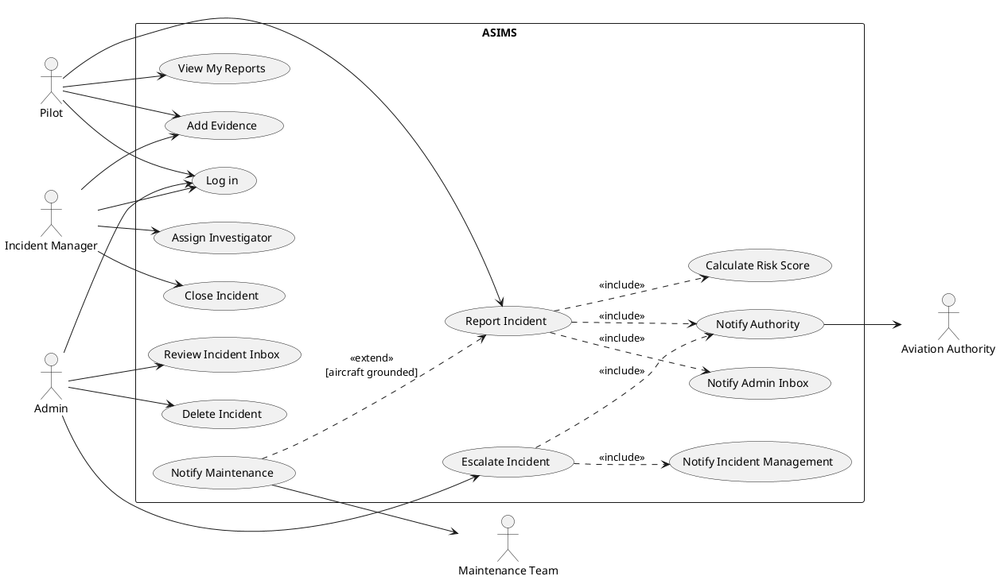
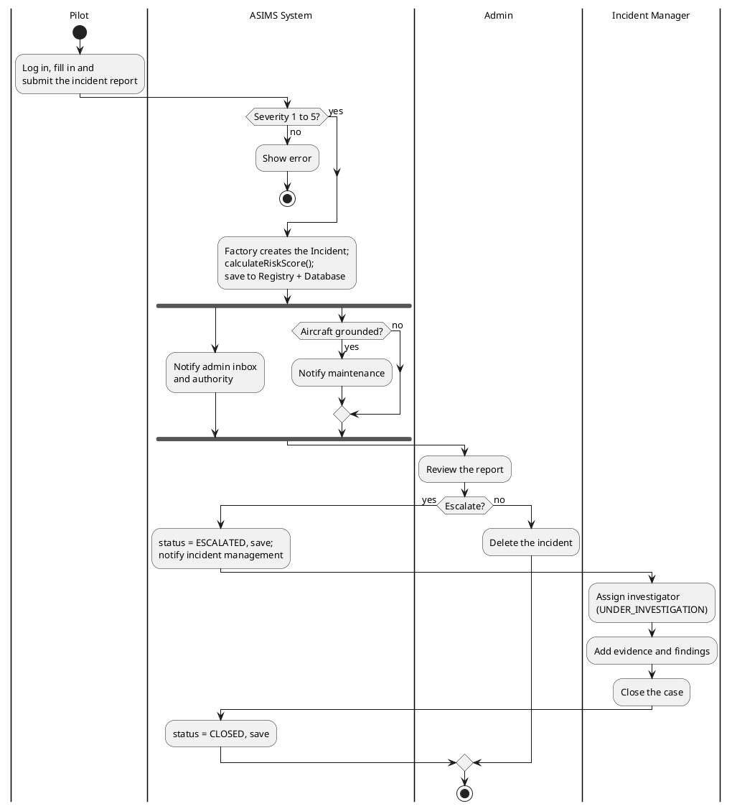
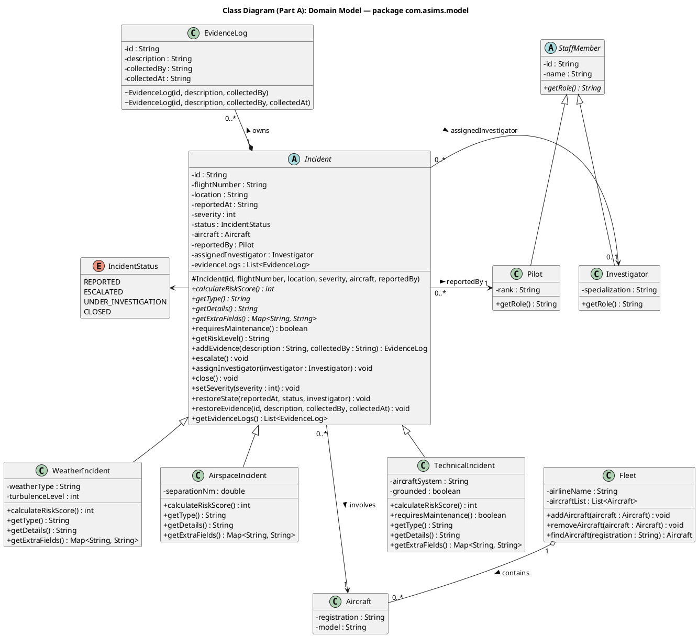
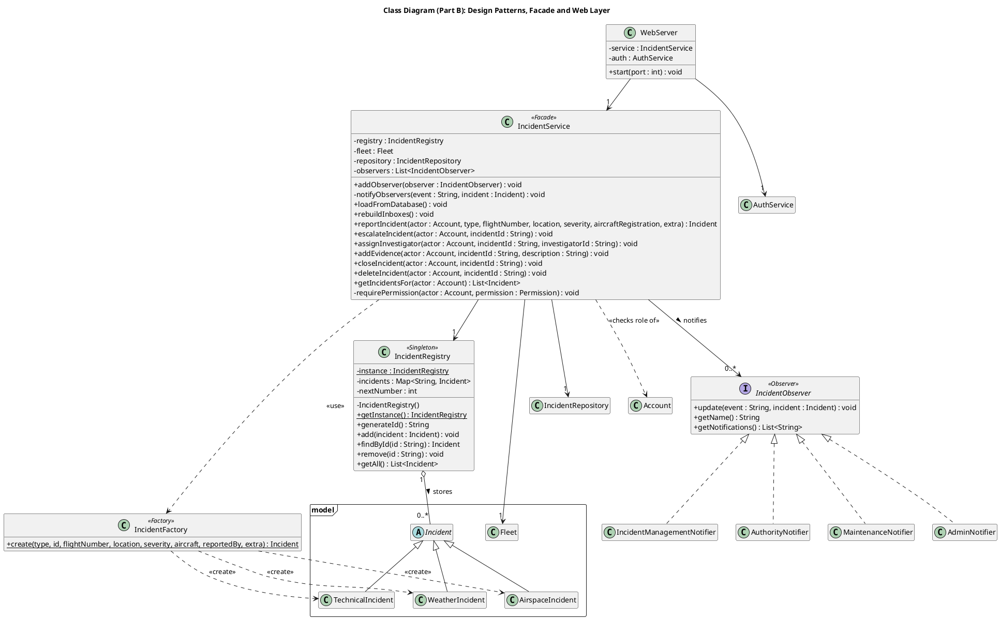
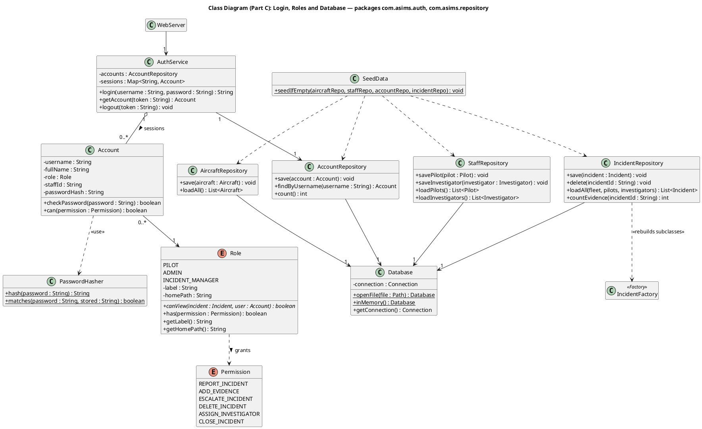
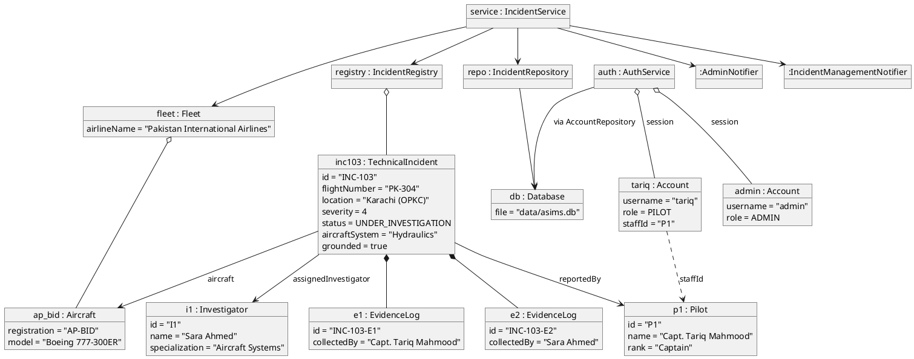
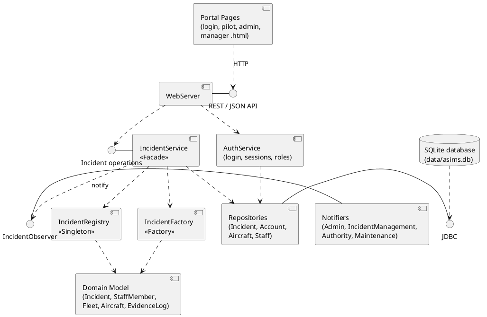
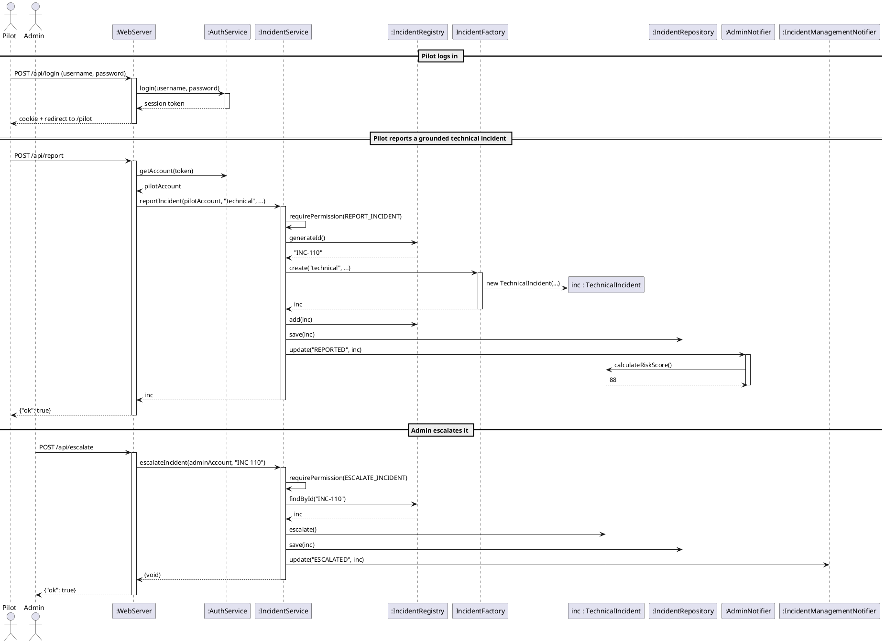
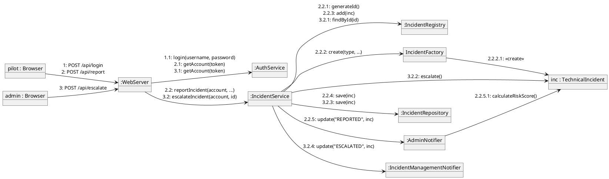
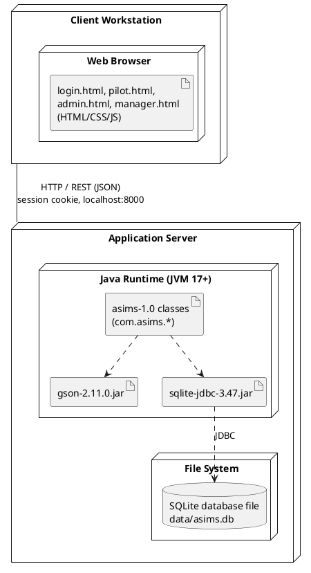

# ASIMS — UML Diagrams

All 8 diagrams are written in **PlantUML**, using the exact class, attribute and method names from the Java code in `src/main/java/com/asims`.
Ready-made SVG images of every diagram are in the `UML_DIAGRAMS/` folder (same file names as below).

**To redraw one:** paste its code block into https://www.plantuml.com/plantuml, or use the PlantUML extension in VS Code (`Alt + D`).

---

## 1. Use Case Diagram

Actors: Pilot, Admin, Incident Manager (each with their own portal) and the external Aviation Authority and Maintenance Team. Every user must log in. `<<include>>` marks steps that always happen; `<<extend>>` marks a step that only happens under a condition (aircraft grounded).

Image: `UML_DIAGRAMS/01-use-case.svg`

---

## 2. Activity Diagram: report, escalate, investigate and close an incident

Four swimlanes (Pilot, ASIMS System, Admin, Incident Manager), decision diamonds and a fork/join for the notifications.

Image: `UML_DIAGRAMS/02-activity.svg`

---

## 3a. Class Diagram, Part A: Domain Model

Classes of the `model` package: inheritance, composition (`*--`, Incident to EvidenceLog), aggregation (`o--`, Fleet to Aircraft) and associations with multiplicities.

Image: `UML_DIAGRAMS/03a-class-model.svg`

---

## 3b. Class Diagram, Part B: Design Patterns, Facade and Web Layer

The four GoF patterns with their stereotypes (Singleton, Factory, Observer, Facade) and the web server.

Image: `UML_DIAGRAMS/03b-class-patterns.svg`

---

## 3c. Class Diagram, Part C: Login, Roles and Database

Roles and permissions, accounts, password hashing, sessions and the repositories that talk to SQLite.

Image: `UML_DIAGRAMS/03c-class-security.svg`

---

## 4. Object Diagram: system state after start-up

Run-time snapshot using the seeded data (incident INC-103 with its evidence, the pilot, the investigator, the observers and two logged-in accounts).

Image: `UML_DIAGRAMS/04-object.svg`

---

## 5. Component Diagram

Components with provided interfaces (lollipops): REST/JSON API, incident operations, IncidentObserver and JDBC.

Image: `UML_DIAGRAMS/05-component.svg`

---

## 6. Sequence Diagram: login, report and escalate an incident

Time-ordered messages for a pilot logging in and reporting a grounded technical incident, then the admin escalating it.

Image: `UML_DIAGRAMS/06-sequence.svg`

---

## 7. Communication Diagram: login, report and escalate

The same scenario as the sequence diagram, drawn as numbered messages on object links.

Image: `UML_DIAGRAMS/07-communication.svg`

---

## 8. Deployment Diagram

Client workstation with a web browser, and the application server (JVM) that holds the SQLite database file.

Image: `UML_DIAGRAMS/08-deployment.svg`

---
